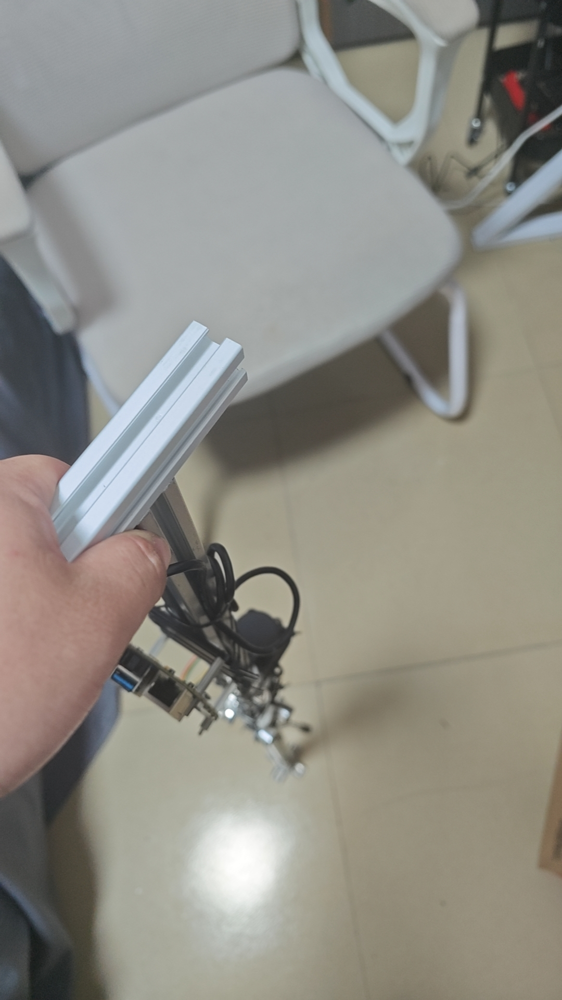
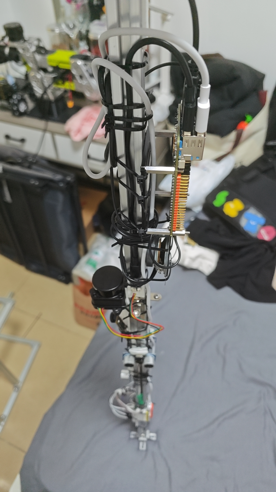
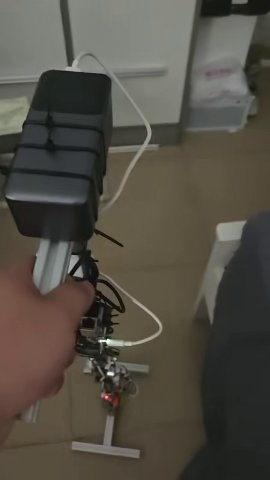
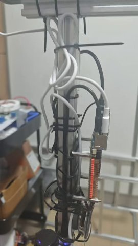
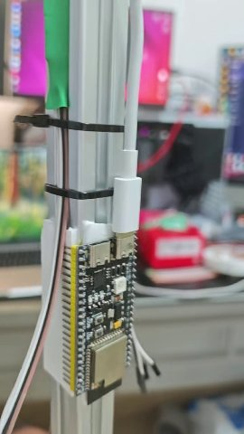
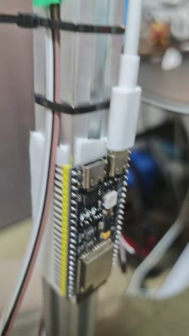

# 智能导盲杖 (Guide Cane) — RDK X5

基于地平线 **RDK X5**(Ubuntu 22.04 / ROS2 Humble / Python 3.10)的多传感器融合避障导盲杖。超声波、单线激光雷达、单目摄像头三路数据融合做危险分级,通过**语音播报**提示障碍方向与可通行路线,并内置一个无第三方依赖的 **Web 控制台**用于标定与调参。

> ⚠️ 本仓库**不含任何 API 密钥**。云端语音/视觉需要 DashScope Key,请自行配置(见下文「密钥配置」),切勿把密钥提交到仓库。

## 图片与视频

### 实物照片

| 手持实物 | 硬件与传感器安装 |
|:---:|:---:|
|  |  |

### 演示视频

点击预览图或下方文字打开 MP4 原视频。

| 演示视频 1 | 演示视频 2 |
|:---:|:---:|
| <a href="assets/videos/demo-01.mp4?raw=true"></a><br>[演示视频 1 · 23.4 秒](assets/videos/demo-01.mp4?raw=true) | <a href="assets/videos/demo-02.mp4?raw=true"></a><br>[演示视频 2 · 14.5 秒](assets/videos/demo-02.mp4?raw=true) |

| 演示视频 3 | 演示视频 4 |
|:---:|:---:|
| <a href="assets/videos/demo-03.mp4?raw=true"></a><br>[演示视频 3 · 16.3 秒](assets/videos/demo-03.mp4?raw=true) | <a href="assets/videos/demo-04.mp4?raw=true"></a><br>[演示视频 4 · 14.4 秒](assets/videos/demo-04.mp4?raw=true) |

本仓库包含全部 **2 张原始照片与 4 个原始视频**，文件未压缩、未转码。原始文件名、大小与 SHA-256 校验值见 [媒体清单](assets/manifest.json)。

## 功能概览

- **多传感器融合**:三路超声波(ESP32-S3)+ COIN-D6 单线激光雷达(`/scan`)+ 斜装摄像头,按方向取最近距离做危险分级。
- **危险分级报警**:DANGER ≤ 30cm / WARN ≤ 70cm / CAUTION ≤ 110cm(阈值可在 Web 实时改),每轮只报最危险方向,避免信息过载。
- **语音播报**:云端 **qwen3-tts-flash**(男声 Ethan)为主,本地 **piper** 神经网络 TTS、**espeak-ng** 机械音为离线回退;固定短语后台预渲染到缓存,断网可用。
- **语音优先级仲裁**:按类别(危险/警告/注意/导航/视觉)设优先级与最小间隔,只有 DANGER 可打断正在播放的语音;支持按类型分别静音。
- **可通行方向导航**:雷达把前方弧区分成 5 个方向区,当正前方被挡时提示绕行方向。
- **视觉识别播报**:云端 **qwen3-vl-flash** 抓拍描述前方物体,支持 Web 手动触发与定时自动播报。
- **Web 控制台**(`:8090`,Python 标准库 `http.server`,零第三方依赖):实时状态、摄像头、雷达标定、参数设置、语音测试。

## 硬件与设备节点

| 部件 | 设备节点 | 说明 |
|---|---|---|
| ESP32-S3 三路超声波 | `/dev/esp32_ultra`(→ ttyUSB0) | 115200,JSON `{"front","left","right"}` cm,`"empty"`=不可测 |
| COIN-D6 单线激光雷达 | `/dev/sc_mini`(→ ttyUSB1) | 由 ROS2 包 `m1ct_d2` 驱动,发布 `/scan` |
| 单目 RGB 摄像头(斜装) | `/dev/video0` | OpenCV 检测地面矮障碍 + 供视觉大模型抓拍 |
| 扬声器 | ALSA `default`(ES8326) | `aplay` 异步播放 WAV |

## 架构数据流

```
ESP32 超声波 ─┐
COIN-D6 /scan ─┼─→ fusion(每方向取最近距离) ─→ 危险分级 ─┬─→ 语音播报(qwen TTS / piper / espeak)
斜装摄像头   ─┘                                        ├─→ 可通行方向导航(navigator)
                                                       └─→ 视觉识别播报(qwen-vl)
           Web 控制台(:8090) ── 实时状态 / 参数 / 标定 / 语音测试
```

- 距离统一用 cm;参数运行时可改:`config.py` 为默认值,Web 保存的覆盖写入 `settings.json`,多数即时生效(少数标注需重启)。

## 目录结构

```
.
├── guidecane/                 # 导盲杖主程序(部署到板子 /home/sunrise/guidecane/)
│   ├── guidecane/             # Python 业务模块
│   │   ├── main.py            # 主循环:采集→融合→分级→播报/导航/视觉
│   │   ├── ultrasonic.py      # ESP32 超声波串口读取
│   │   ├── lidar.py           # 订阅 /scan,扇区/方向区距离
│   │   ├── camera.py          # OpenCV 采集 + 矮障碍启发式检测
│   │   ├── fusion.py          # 多源融合 + 危险分级
│   │   ├── navigator.py       # 5 方向区可通行判定与绕行建议
│   │   ├── audio.py           # 语音合成 + 优先级仲裁 + 缓存
│   │   ├── vision.py          # qwen-vl 抓拍描述
│   │   ├── apikey.py          # 密钥读取(环境变量 / secrets.env,不入库)
│   │   ├── config.py          # 默认参数
│   │   ├── settings.py        # 运行时参数覆盖层(settings.json)
│   │   ├── webserver.py       # Web 控制台后端
│   │   └── web/               # 前端 index.html / app.js / style.css
│   ├── tools/                 # calibrate_lidar.py(雷达标定)、selftest.py(自检)
│   ├── run_guidecane.sh       # 前台启动脚本
│   ├── guidecane.service      # systemd 单元(开机自启)
│   ├── guidecane.launch.py    # ROS2 launch
│   └── 99-guidecane.rules     # udev 规则(ESP32 稳定符号链接)
├── 雷达ROS2开发包/            # COIN-D6 厂商 ROS2 驱动包(m1ct_d2,复用不重写)
├── 技术文档.md                # 技术栈 / 算法 / 模块职责详解
└── assets/                   # 实物照片、演示视频、视频预览与媒体校验清单
```

## 密钥配置

云端 TTS/视觉需要 DashScope API Key。程序**不读代码里的密钥**,按以下顺序取:

1. 环境变量 `DASHSCOPE_API_KEY`;
2. 主程序同目录下 `secrets.env`(格式 `DASHSCOPE_API_KEY=sk-...`,建议 `chmod 600`,已在 `.gitignore` 忽略)。

```bash
# 板上创建(示例)
echo 'DASHSCOPE_API_KEY=你的key' > guidecane/guidecane/secrets.env
chmod 600 guidecane/guidecane/secrets.env
```

未配置密钥时,语音合成回退到已安装的本地 TTS,云端视觉描述不可用；本地传感器避障仍可运行。

## 部署(RDK X5)

```bash
# 1) 装 udev 规则(ESP32 稳定设备名)
sudo cp guidecane/99-guidecane.rules /etc/udev/rules.d/
sudo udevadm control --reload && sudo udevadm trigger

# 2) 编译并 source 雷达 ROS2 驱动(m1ct_d2),使 /scan 可用
#    将「雷达ROS2开发包」放入 colcon 工作区后 colcon build,再 source install/setup.bash

# 3) 自检
cd guidecane && python3 tools/selftest.py

# 4) 前台试跑
./run_guidecane.sh

# 5) 开机自启
sudo cp guidecane.service /etc/systemd/system/
sudo systemctl daemon-reload
sudo systemctl enable --now guidecane
journalctl -u guidecane -f
```

## Web 控制台

浏览器打开 **http://<板子IP>:8090**,共 5 个页签:实时状态、摄像头、雷达标定、参数设置、语音测试；雷达扫描显示位于雷达标定页。

- **雷达标定**:把障碍放到杖体某方向约 1m 处,点对应按钮即可写入该方向角度;也可手动填角度/扇区半角。
- **参数设置**:分组列出全部参数(超声波/雷达/摄像头/分级/语音/音频/导航/视觉/Web),可编辑、保存、恢复默认、重启服务。
- **语音测试**:逐条试听各方向×级别播报,并提供静音/分类开关。

> 无鉴权,仅限局域网使用,**切勿暴露公网**。

## 依赖

- Python 3.10;ROS2 Humble + `rclpy`(订阅 `/scan`)。
- `pyserial`(超声波)、`opencv-python` + `numpy`(摄像头)。
- 本地 TTS:`piper-tts`(模型 `zh_CN-huayan-medium.onnx`)、`espeak-ng`。
- Web 与 HTTP:Python 标准库 `http.server` / `urllib`,无第三方 Web 框架。
- 云端:DashScope `qwen3-tts-flash`、`qwen3-vl-flash`(需 `DASHSCOPE_API_KEY`)。

## 备注

- 摄像头矮障碍检测为**启发式**(边缘密度),无深度信息,仅作提示;`camera.py` 的 `detect()` 已隔离,日后可换 BPU 目标检测模型。
- 雷达复用厂商 `m1ct_d2` 驱动;`guidecane.service` 与板载 `octr-base/driver` 服务互斥(独占雷达串口)。
- Web「重启服务」按钮可选依赖免密 sudo,需用户手动安装(出于安全不自动写入):
  ```bash
  echo 'sunrise ALL=(root) NOPASSWD: /usr/bin/systemctl restart guidecane' \
    | sudo tee /etc/sudoers.d/guidecane-restart && sudo chmod 440 /etc/sudoers.d/guidecane-restart
  ```
  不装也可,手动 `sudo systemctl restart guidecane` 即可。

详细技术栈与算法见 [技术文档.md](技术文档.md)。
